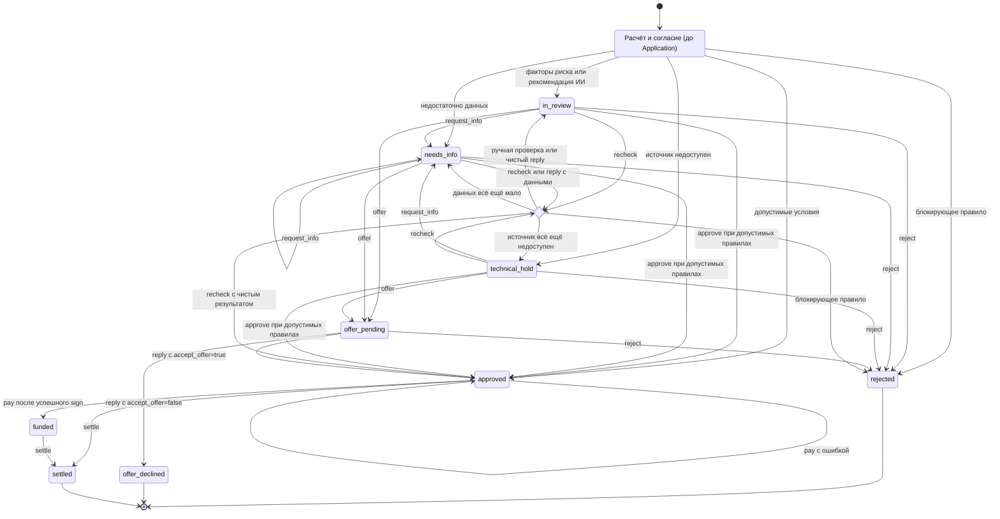
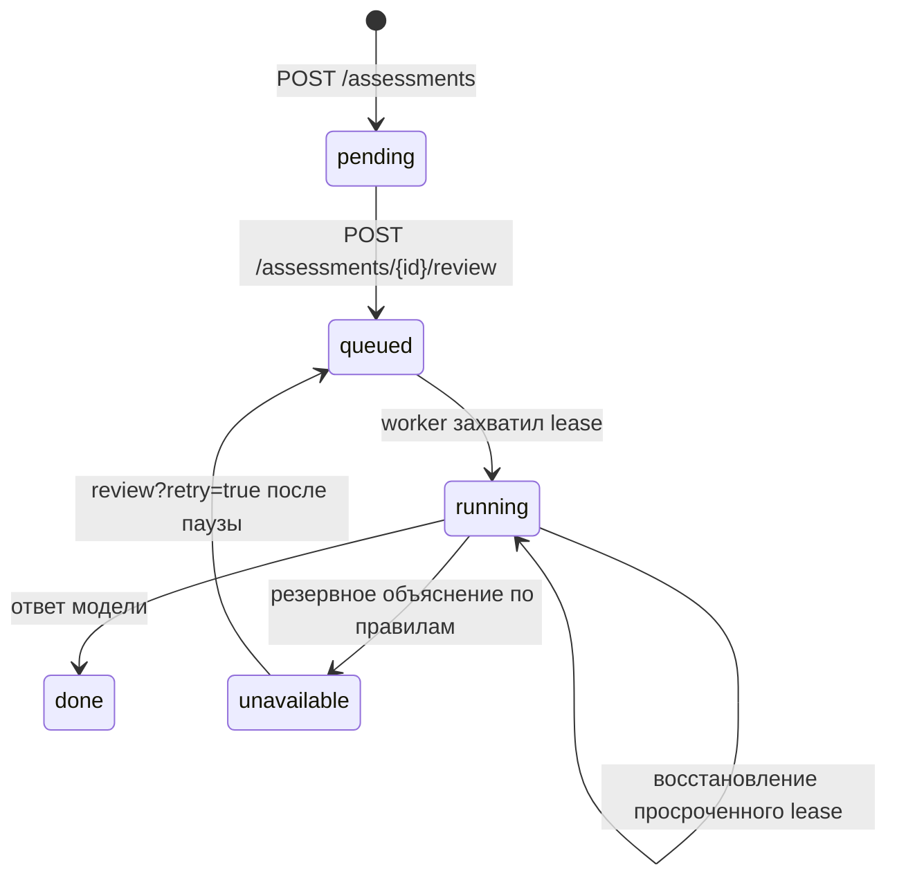

# Состояния заявки

Источник переходов — [`services/platform/api.py`](../services/platform/api.py), автоматического результата — [`engine.py`](../services/platform/engine.py) и [`review.py`](../services/platform/review.py). Статусы заявки и задания заключения — разные сущности.

## Жизненный цикл заявки

Черновик и предварительный расчёт существуют до создания `Application`; статусов `draft` или `assessment` в таблице заявок нет. При отправке сохраняется сразу результат правил с учётом заключения.

| Статус | Значение и следующее действие |
| --- | --- |
| `approved` | Одобрено; сотрудник может оформить договор, выдать средства или погасить обязательство |
| `in_review` | Ручное рассмотрение; решение, уточнение, повторная проверка или оффер |
| `rejected` | Отказ; доступен просмотр оснований и истории |
| `needs_info` | Нужны сведения; клиент готовит новую анкету и завершённый расчёт, затем отвечает |
| `technical_hold` | Техническое ожидание; сотрудник повторяет проверку или запрашивает уточнения |
| `offer_pending` | Новые условия ожидают явного согласия клиента |
| `offer_declined` | Клиент отклонил новые условия; процесс завершён |
| `funded` | Симуляция выдачи завершена; возможно погашение |
| `settled` | Симуляция погашения завершена; обязательство освобождено |

## Условия переходов

Все команды `/actions` доступны только сотруднику. `/reply` — только клиенту-владельцу. Они требуют актуальную `version` и комментарий. Сохранение результата, увеличение версии, события и снимка происходит в одной транзакции. Устаревшая версия возвращает 409 `APPLICATION_CHANGED` без применения команды.

| Команда | Исходные статусы | Результат / ограничение |
| --- | --- | --- |
| `approve` | `in_review`, `needs_info`, `technical_hold` | Новый расчёт должен разрешать одобрение; `rejected`, `needs_info`, `technical_hold` дают 422 `POLICY_BLOCKED` |
| `reject` | `in_review`, `needs_info`, `technical_hold`, `offer_pending` | `rejected` |
| `request_info` | `in_review`, `needs_info`, `technical_hold` | `needs_info` |
| `recheck` | `in_review`, `needs_info`, `technical_hold` | Точный статус нового расчёта с применимым сохранённым заключением |
| `offer` | `in_review`, `needs_info`, `technical_hold` | `offer_pending`; сумма/срок обязательны, блокирующий расчёт не допускается |
| `reply` с `data` | `needs_info` | Новая ревизия; чистый результат возвращается в `in_review`, остальные результаты сохраняют статус расчёта |
| `reply` с `accept_offer` | `offer_pending` | `approved` или `offer_declined`; нужны актуальная версия и неистёкший оффер |
| `sign` | `approved` | Статус не меняется; результат в `assessment.contract`, повтор успешного оформления запрещён |
| `pay` | `approved` | Успех → `funded`, ошибка → `approved`; нужен успешный договор, гарантия не предусматривает выплату |
| `settle` | `approved`, `funded` | `settled`, освобождение портфельного резерва |

Каждая сохранённая попытка `sign`/`pay`, включая симулированную ошибку, увеличивает версию. HTTP 200 в этом случае означает сохранённый результат попытки: проверяйте `contract.success` или `disbursement.success`. Отклонённые запросы (409/422) ревизию не создают.

Оффер действует 30 минут. При истечении статус остаётся `offer_pending`, но ответ клиента отклоняется с `OFFER_EXPIRED`; автоматического статуса `expired` нет. Принятие повторно проверяет расчёт и портфель: изменение условий даёт `OFFER_CHANGED`. Блокирующие правила не отменяются ни сотрудником, ни LLM. Для ответа на уточнение нужен новый завершённый `assessment_id`, привязанный к той же анкете и компании.

## Состояния задания заключения

Lease длится 120 секунд; `started_at` служит маркером попытки. Общий срок расчёта — 30 минут: просроченные задания не выдаются клиенту и не берутся worker. Отдельного сохраняемого состояния `expired` нет. `done` и `unavailable` разрешают отправку заявки; `pending`, `queued`, `running` дают `AI_REVIEW_REQUIRED`. Резервный режим маркируется явно. Доставка после сбоев допускает повторный вызов провайдера.
