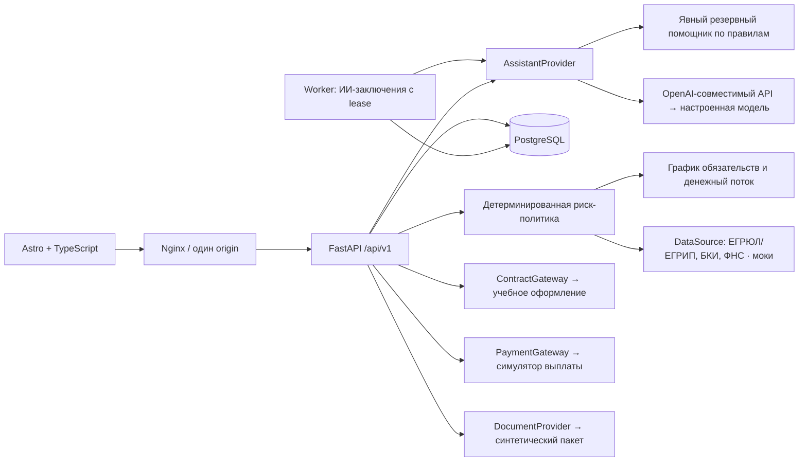

# Реализованная архитектура

Новый продукт использует `/api/v1` и Astro-кабинет `/cabinet/`. Старый FastAPI-прототип и его API сохранены для совместимости, но новый UI не зависит от ИИ-подбора старого интерфейса.

`services/platform/catalog.py` содержит продукты и требования к документам; `engine.py` — расчёт и риск-политику; `adapters.py` — контракты `DataSource`, `PaymentGateway`, `AssistantProvider`; `api.py` — авторизацию демопрофилей, транзакции и команды процесса. Новую интеграцию реализуют наследованием контракта и регистрацией в композиции приложения. Произвольный импорт классов из пользовательского ввода не допускается.

Проверки и расчёты выполняются синхронно: локальные моки быстрые. ИИ-заключение выполняется отдельным worker через сохранённый AssessmentRun: pending → queued → running → done/unavailable. Атомарный lease на 120 секунд предотвращает одновременную обработку, просроченный запуск восстанавливается. Вызов прокси ограничен общим сроком 80 секунд и не удерживает соединение/транзакцию БД. HTTP возвращает 202, UI опрашивает статус. Для локального запуска worker запускается lifespan API; в Compose это отдельный процесс. Доставка — как минимум один раз после сбоев; exactly-once вызов провайдера не обещается. Универсальный outbox для всех интеграций и Kafka не реализованы. Полная карта развития сохранена в `implementation-plan.md`; её пункты не означают наличие этих функций сейчас.

## Данные

Полная [модель данных и ER-диаграмма](data-model.md) описывает семь таблиц `conveyor_*`, ключи, JSON-снимки и форматы времени. Серверная анкета и команды описаны в [API](api.md); машинный контракт — [OpenAPI](openapi.json), воспроизводимая последовательность — [коллекция запросов](requests.http).

Аккаунт соответствует одной демонстрационной компании или роли сотрудника. Роли берутся с сервера. Демоаккаунты общие для всех проверяющих стенда: это явно обозначено на экране входа. Новая модель не реализует production-регистрацию, членство в нескольких организациях, корпоративный SSO или MFA. Старые регистрация и почтовое восстановление существуют в историческом интерфейсе и не требуются для проверки нового продукта.

Сессия: случайный непрозрачный token в HttpOnly/SameSite cookie; в БД только SHA-256 token. CSRF-token проверяется на изменяющих запросах, logout отзывает сессию. Демовход включается `DEMO_MODE=true`; он намеренно предоставляет тестовую роль сотрудника. Продолжительность сессии — 4 часа.

У компании есть транзакционная блокировка через UPDATE строки Account. Отправка заявки и действия сотрудника сериализованы относительно портфеля. Перед сохранением заявки расчёт повторяется, fingerprint должен совпадать с подтверждённой версией. `Idempotency-Key` привязан к аккаунту и хешу запроса; повтор команды отправки возвращает сохранённую заявку. Действия сотрудника и ответы клиента защищены `version` и условным UPDATE.

Состояние, событие и снимок ревизии сохраняются одной транзакцией. При уточнении новый снимок не уничтожает предыдущий. История и снимки защищены на уровне API; администратор БД всё ещё способен изменить их. Внешнее WORM-хранилище аудита не реализовано.

## Состояния

Полная [диаграмма состояний заявки](application-states.md) содержит переходы, разрешённые роли и ограничения команд. До отправки существуют черновик и расчёт; при создании заявки сразу сохраняется результат `approved`, `in_review`, `rejected`, `needs_info` или `technical_hold`. Повторный расчёт может вернуть любой из этих результатов. Оформление договора хранится внутри `approved`, успешная выплата переводит в `funded`, погашение — в `settled`. Состояния задания заключения описаны отдельно от статусов заявки.

Оффер действует 30 минут. Просроченный оффер нельзя принять; фоновый перевод в отдельный статус истечения не реализован. Повторная проверка `technical_hold` вернёт ожидание, если выбранный мок по-прежнему недоступен. При уточнении можно выбрать восстановившийся тестовый пакет, сохранив новую ревизию.

## Деньги, риски и портфель

Аннуитет рассчитывается с Decimal и округлением до копейки, последний платёж корректируется по оставшемуся долгу. Денежные JSON-значения передаются числами; это демонстрационная финансовая модель, не банковский ledger. Целевые поступления от кредита и затраты на проект взаимно погашаются в начале периода, аванс лизинга уменьшает исходный остаток.

Овердрафт и факторинг используют упрощённый bullet-график. Линия моделирует полную выборку лимита. Гарантия создаёт комиссию и резерв обязательства без перечисления денег, стресс включает требование по гарантии. Полноценные юридические условия, НДС, страхование, регресс и расчёты с поставщиком не моделируются.

Внешние платежи берутся как max(анкета, мок БКИ), чтобы не удваивать один долг. К ним добавляются серверные обязательства по одобренным/выданным заявкам. Полная сумма и максимальный платёж резервируются до симуляции погашения; автоматической амортизации портфеля по календарю нет. Рефинансирование заменяет только явно указанный внешний платёж, не списывает произвольно собственные обязательства.

Ставка = ставка продукта + надбавка за сценарий риска, активный портфель и молодой бизнес. LLM не назначает ставку и не принимает финансовое решение. Базовый дефицит или непосильный платёж блокируют одобрение; стресс-дефицит и предупреждения передают заявку сотруднику. Недоступность источника не считается чистой проверкой. Скоринг не является вероятностью одобрения.

## Эксплуатация

Docker: Nginx, API, worker, PostgreSQL. Python-зависимости закреплены в requirements.lock, frontend — package-lock.json. Alembic выполняется до API, `AUTO_CREATE_SCHEMA=false` в Compose. Локальный быстрый запуск поддерживает SQLite с автоматическим созданием таблиц; схемные миграции рассчитаны прежде всего на новый PostgreSQL-стенд. Импорт исторической SQLite-базы в PostgreSQL не автоматизирован.

Логи API содержат request ID, метод, статус и время; ответы API не кешируются. Health проверяет БД. Метрики Prometheus, трассировка и кластерная отказоустойчивость пока не реализованы. Команды проверок и ожидаемые результаты приведены в [тестовых сценариях](testing.md). Контейнерная сборка проверяется отдельным CI workflow; наличие конфигурации не заменяет успешный прогон на целевом стенде.

Резервная копия стенда: `docker compose exec -T postgres pg_dump -U conveyor -d conveyor -Fc > backup.dump`. Восстановление в подготовленную пустую БД: `docker compose exec -T postgres pg_restore -U conveyor -d conveyor < backup.dump`. Перед восстановлением остановить запись API и сохранить текущую копию. Эти команды — инструкция; полноценный DR-drill текущей версией не заявляется.

## Доработки после поэлементного аудита

Каталог расширен до 18 семейств и группируется по задаче. Сравнение альтернатив использует оценку каждого продукта целиком: ставку, аванс, график, документы, реестры и портфель. Отсутствующий пакет другого продукта не считается автоматически приложенным. Модели оборудования сравниваются с лизингом и инвестиционным финансированием; гарантия не подменяется денежным кредитом.

Денежный поток сравнивается с текущей деятельностью без нового проекта. Задержка выручки сдвигает все поступления, включая сезонные; дебиторка после горизонта отображается отдельным значением API. Это исправляет первоначальную модель, где задерживались только первые поступления.

Сохранённое ИИ-заключение включает facts_hash и ссылки на разрешённые факты/правила. Обязательные запреты и неизвестные источники нельзя отменить рекомендацией LLM. Перед отправкой сервер заново проверяет условия и портфель; использованный AssessmentRun должен принадлежать компании, совпадать с данными и быть не старше 30 минут. При неизменных фактах заключение сохраняется в действиях аналитика; изменённые факты не получают старое заключение автоматически. Ревизии доступны отдельным API и через интерфейс.

Чат возвращает структурированное предложение. По отдельному действию клиента сервер проверяет его, ограничивает параметры каталогом и создаёт черновик с ИНН текущей компании. Клиент проверяет все значения и подтверждает новые условия; ответ модели сам по себе заявку не создаёт.

Точки расширения DataSource, DocumentProvider, ContractGateway, PaymentGateway, AssistantProvider собраны в composition.py. Учебное оформление создаёт хеш документа; выдача требует успешного оформления. Ошибка подписи или платежа сохраняется с новой версией и не считается успехом.

GET /api/v1/feed возвращает события только разрешённых заявок. Это персональная событийная лента кредитного продукта, без внешних редакционных новостей. Списки используют серверный поиск до пагинации. Сводка и счётчик заявок не зависят от текущей страницы списка. Рабочая очередь обновляется периодически, карточка замечает смену версии; комментарий сотрудника не стирается автоматическим обновлением.

### Проверяемое заключение review-v2

Модель получает каталог серверных фактов с идентификаторами. Она выбирает важные ссылки и формулирует качественное мнение. Текст каждого основания и все его числа берутся из каталога сервера: новый платёж, внешняя нагрузка и платежи ранее одобренного портфеля разделены; прогноз показывает денежный остаток, а не доход. Неизвестные ссылки отбрасываются. Если модель нарушила запрет на цифры в качественном резюме, пользователю показывается серверное резюме; сырой текст остаётся в сохранённом заключении для аудита. Это ограничение численных галлюцинаций, а не доказательство истинности произвольной фразы LLM.

При допустимом результате правил рекомендация модели о дополнительной проверке переводит заявку на сотрудника (`AI_MANUAL_REVIEW`). Отказ или снятие обязательного ограничения только на основании модели не выполняется. Для исторической заявки без привязанного заключения показывается резюме из сохранённых расчётных фактов без нового сетевого вызова.
