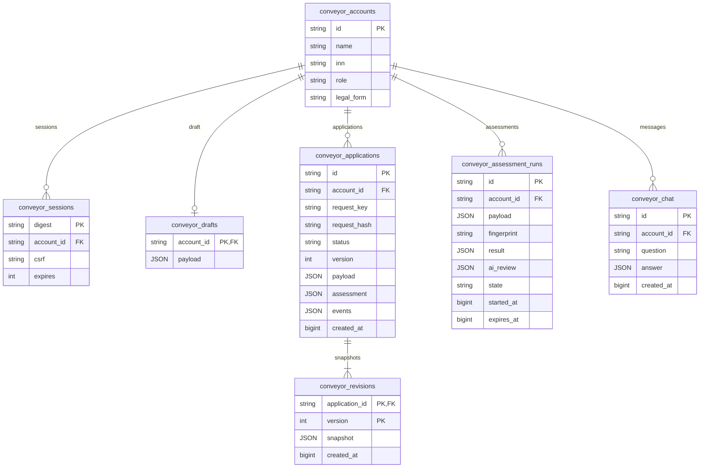

# Модель данных

Реализованные ORM-сущности кабинета находятся в [`services/platform/models.py`](../services/platform/models.py), миграции — в [`migrations/`](../migrations/). PostgreSQL используется в Compose, SQLite — для быстрого локального запуска. Названия на диаграмме соответствуют таблицам БД.

## Таблицы и ключи

| Таблица | Назначение и ограничения |
| --- | --- |
| `conveyor_accounts` | Демокомпания или сотрудник. PK `id` (до 20 символов), ИНН до 12, роль `client`/`staff`; один аккаунт соответствует одной компании. ИНН не имеет UNIQUE-ограничения |
| `conveyor_sessions` | PK `digest` — SHA-256 случайного cookie-токена; исходный токен не хранится. FK `account_id`, CSRF и срок сессии |
| `conveyor_drafts` | PK/FK `account_id` обеспечивает не более одного черновика на аккаунт. `payload` — нормализованная анкета |
| `conveyor_applications` | UUID в строковом PK. UNIQUE (`account_id`, `request_key`) для отправки, хеш тела `request_hash`; индексы на владельце и статусе. `version` начинается с 1 |
| `conveyor_revisions` | Составной PK (`application_id`, `version`), FK заявки. Снимок при отправке и каждом сохранённом изменении |
| `conveyor_assessment_runs` | UUID в строковом PK, FK/индекс владельца. Анкета, хеш подтверждённого расчёта, результат правил и заключение worker |
| `conveyor_chat` | UUID в строковом PK, FK/индекс владельца. Вопрос до 2000 символов и структурированный ответ |

Все перечисленные ORM-поля обязательны (`nullable=False`). Допустимые статусы и роли контролируются приложением, SQL ENUM для них нет. Автоматическое каскадное удаление и очистка истёкших сессий/расчётов не настроены.

## Содержимое JSON

| Поле | Содержимое |
| --- | --- |
| `Application.payload`, `Draft.payload`, `AssessmentRun.payload` | `Input`: продукт, сумма/срок/цель, ИНН, финансовые показатели, возраст, сценарий, признаки документов, стресс и тестовые факторы |
| `Application.assessment`, `AssessmentRun.result` | Риск/балл, условия, график, портфель, базовый и стрессовый денежный поток, проверки, документы, правила, альтернативы, версии каталога и политики |
| `Application.assessment.ai_review` | Объяснение, режим `llm`/резервный, модель/провайдер при наличии, привязка к фактам и рекомендация |
| `Application.assessment.offer` | Предложенная анкета `data`, её `assessment`, время истечения `expires` |
| `Application.assessment.contract` / `disbursement` | Результаты симуляции оформления и выплаты, включая признак `success` |
| `Application.events` | Массив событий: `id`, `actor`, `action`, `comment`, `at`; внутренние события фильтруются для клиента |
| `ApplicationRevision.snapshot` | Объект из `status`, `data`, `assessment` соответствующей версии; события хранятся в текущей заявке |
| `ChatTurn.answer` | Текст, режим, вопросы и предложение; `application_id` внутри JSON логически связывает диалог с заявкой |

В `Application` нет FK на `AssessmentRun`: идентификатор использованного расчёта сохраняется в JSON `assessment.assessment_id`, принадлежность/срок/совпадение проверяются API. `ChatTurn.answer.application_id` тоже не является FK. Это ограничения текущей модели.

Документы нового кабинета — синтетические структуры внутри расчётов; отдельной таблицы файлов в `conveyor_*` нет. Каталог продуктов и риск-политика задаются кодом с версиями. Портфель выводится из заявок `approved`/`funded`, не хранится отдельным банковским ledger.

## Согласованность и форматы

- Изменения портфеля сериализуются через UPDATE строки аккаунта. Команды дополнительно выполняют условный UPDATE заявки по `version`.
- Состояние, история и ревизия фиксируются одной транзакцией. Ревизии не изменяются через API; защита от администратора БД не реализована.
- `fingerprint` — SHA-256 JSON из нормализованных `data` и `result`; `request_hash` — хеш тела отправки. Они решают разные задачи: согласие с расчётом и идемпотентность.
- `created_at` и `events.at` — Unix time в миллисекундах. Сроки сессий, расчётов, офферов и `started_at` — Unix time в секундах.
- Входные денежные значения — целые рубли, расчёт выполняется с Decimal и округлением до копейки, JSON содержит числа. Это демонстрационная модель, без отдельного типа валюты и проводок.

## Исторический API

В общей БД сохранены отдельные таблицы `user`, `bank_staff`, `uploaded_documents`, `credit_assessments`, `credit_applications`, `application_events` для прежнего прототипа. Их ORM описан в [`services/db.py`](../services/db.py). Они не связаны FK с `conveyor_*`; новый Astro-кабинет не использует их регистрацию, файлы и заявки. Основная ER-диаграмма выше ограничена текущим продуктовым путём.
