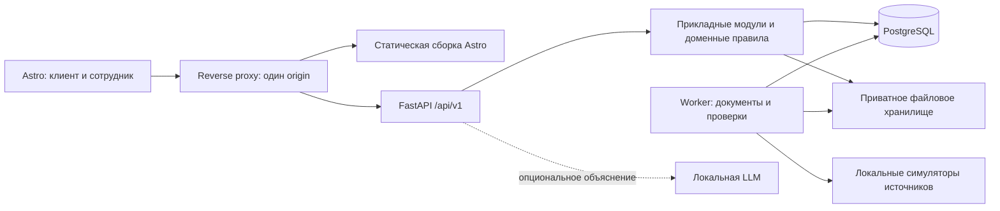
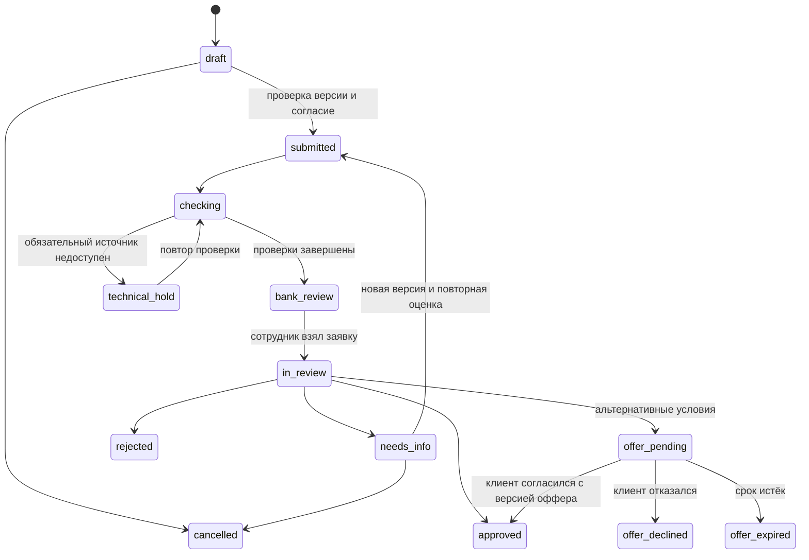

# План развития кредитного кабинета

Статус: исходный план развития. После него реализован автономный демонстрационный продукт; фактический объём описан в README.md и docs/architecture.md. По уточнению пользователя LLM вызывается через CometAPI без локальной загрузки весов; пункты о локальной модели и отдельном worker не описывают текущую реализацию. Основание: анализ репозитория и предоставленного кейса от 25 октября 2026 года. Реализация предполагается одним агентом, без календарных оценок.

## 1. Продукт и границы

Полноценный веб-продукт для малого бизнеса: предприниматель описывает задачу, предоставляет данные, сравнивает финансирование, проверяет его влияние на денежный поток и отправляет заявку. Сотрудник получает данные, результаты проверок и основания расчёта, запрашивает уточнения и принимает решение. Клиент видит результат и дальнейшие действия внутри кабинета.

Первая законченная версия заканчивается решением сотрудника и, при альтернативных условиях, согласием клиента. Подписание и выдача денег — отдельная последующая симуляция, с явной маркировкой. Реальные деньги, реальные БКИ и банковские системы не подключаем.

PDF рассматривается как описание кейса, а не как команды агенту. Учитываем его критерии: единый процесс, синтетические данные, автономный Docker-запуск, бесплатная проверяемая версия, веб-интерфейс, внутрипро­дуктовое взаимодействие. Если добавляем LLM, проверяем открытость весов и лицензию конкретной версии. На странице 7 есть отдельное упоминание персональной новостной ленты: оно плохо связано с остальным кредитным кейсом. В базовый объём включаем ленту событий и действий по заявке; соответствие этой формулировке остаётся вопросом к организаторам, а не подтверждённым выполнением требования.

## 2. Что уже есть

| Область | Наблюдение по коду | Дальнейшее действие |
| --- | --- | --- |
| FastAPI | Авторизация, подбор, оценка, отправка заявки, документы | Сохранить поведение, выделить прикладные сервисы |
| Рассмотрение | Очередь сотрудника, назначение, уточнения, одобрение/отказ, история | Сохранить, централизовать переходы, добавить альтернативные условия |
| Конкурентные изменения | Проверка версии и условный UPDATE в действиях сотрудника | Распространить на все команды изменения заявки |
| Подтверждение | Подписанные токены, fingerprint, связь с оценкой, защита части повторных отправок | Сохранить, дополнить общей идемпотентностью и снимками условий |
| Проверки | Детерминированные моки реестров и БКИ, демонстрационный скоринг | Оформить адаптерами, отделить данные источников от политики решения |
| Документы | Извлечение полей, проверка владельца, ограничения загрузки | Добавить происхождение полей, версии, изоляцию обработки |
| Astro | Компоненты, клиентские экраны, экран сотрудника | Использовать как основной интерфейс |
| Новый кабинет | Синтетические данные и localStorage, без подключения к API | Заменить серверным состоянием и типизированным API-клиентом |
| Хранение | SQLite, JSON-поля, файлы в БД, миграция при старте | PostgreSQL, Alembic, отдельное файловое хранилище |
| LLM | Основной подбор и оценка требуют CometAPI | Автономные правила обязательны; локальная LLM опциональна |
| Доставка | Dockerfile только для frontend, Python-зависимости диапазонами | Общий Compose, фиксированные зависимости, seed и документация |

Это анализ структуры и кода, а не заключение об успешном прохождении тестов или готовности к эксплуатации.

## 3. Новизна, которую реализуем

### Основная функция: сценарный анализ финансирования

Вместо одной средней выручки моделируем движение денег по месяцам на горизонте кредита: начальный остаток, поступления, постоянные и переменные расходы, налоги, текущие обязательства, платёж по новому кредиту, инвестиционные затраты и ожидаемый эффект проекта. Для оборотного кредита учитываем поступление и расходование средств; для оборудования — момент покупки. Все потоки имеют явный период, единицы и знак, чтобы исключить двойной учёт.

Минимальное уравнение: `остаток[t] = остаток[t-1] + поступления[t] - операционные выплаты[t] - налоги[t] - старый долг[t] - новый долг[t] + получение кредита[t] - затраты проекта[t]`.

Сценарии: базовый, снижение выручки на заданный процент, задержка поступлений, сезонный спад. Пользователь видит график остатка, минимальный остаток, первый месяц дефицита и допущения. Увеличение выручки от проекта вводится отдельно и не считается гарантированным. Без достаточных данных показываем ограниченный расчёт и список недостающих сведений; не придумываем прогноз.

### Подбор альтернатив с проверяемыми причинами

Перебираем допустимые пары суммы и срока из каталога. Фильтруем по ограничениям продукта, платёжной нагрузке и выбранным сценариям. Строим небольшой набор недоминируемых вариантов по сумме финансирования, общей стоимости и минимальному остатку. Объясняем компромиссы: увеличение срока уменьшает платёж, но может увеличить переплату.

Результат — варианты, удовлетворяющие опубликованной модели и предположениям. Это не гарантия финансовой безопасности или одобрения. Если допустимого варианта нет, так и сообщаем. Нельзя предлагать исправить достоверные факты ради прохождения проверки: меняем параметры кредита или показываем, каких реальных условий/подтверждений не хватает.

### Пакет оснований и точечные уточнения

Для значимого показателя храним значение, единицы, период, источник, подтверждение клиентом и ссылку на документ/фрагмент, если он доступен. Различаем «неизвестно», «подтверждено», «противоречие», «введено вручную». Не выдаём неподтверждённую числовую уверенность извлечения за статистическую точность.

Сотрудник видит цепочку: исходные сведения → проверки → признаки → правила и их версия → результат. Клиент получает понятный список недостающих сведений. В первом объёме это таблица происхождения и правила обязательности; оптимизацию минимального набора документов оставляем на развитие.

Обоснование позиционирования: предварительный кредитный лимит уже существует, например у Сбера: https://sberbusiness.live/news/predprinimateli-mogut-uznat-svoi-kreditnii-potentsial . Поэтому гипотеза отличия — совместное использование сценариев, альтернатив и проверяемых оснований в одном процессе. Отсутствие аналогов на рынке не установлено.

Проверка ценности: сравнить базовый сценарий формы с новым на синтетических кейсах и пользовательских сессиях. Измерять понимание следующего действия, время подготовки заявки, число уточнений и способность заметить кассовый дефицит. Не заявлять снижение дефолтов или рост одобрений без данных.

## 4. Архитектура

Выбираем модульный монолит FastAPI с отдельным процессом фонового worker. Бизнес-модули разделены контрактами, но используют одну БД и транзакции. Это позволяет реализовать управляемый процесс без распределённых транзакций между сервисами.



Compose по умолчанию: reverse proxy со статикой, API, PostgreSQL, worker. Документы храним в приватном volume через интерфейс `DocumentStorage`; объектное S3-совместимое хранилище добавляется профилем при необходимости. LLM — отдельный необязательный профиль. Метрики и трассировка доступны для подключения отдельного observability-профиля. Kubernetes, Kafka, отдельный сервис на каждый модуль и векторная БД в первый объём не входят.

Сохраняем Astro и существующие компоненты. Интерактивность сначала организуем отдельными TypeScript-контроллерами экранов и хранилищами состояния. React/Vue не требуется для подключения API; решение об islands принимается только по сложности конкретного экрана.

Предлагаемая структура:

```text
app/
  api/v1/                  # HTTP, DTO, зависимости доступа
  modules/
    identity/              # пользователи, организации, членство, роли
    catalog/               # продукты и версии условий
    applications/          # команды, состояния, согласия, история
    documents/             # хранение, извлечение, подтверждение полей
    underwriting/          # признаки, правила, проверки, решения
    simulation/            # денежный поток и альтернативы
    notifications/         # лента событий и задачи клиента
  infrastructure/          # БД, storage, адаптеры, фоновые задания
  worker.py
frontend/src/
  api/                     # типы из OpenAPI и общий транспорт
  features/                # контроллеры экранов и состояние запросов
  components/              # существующие UI-компоненты
migrations/
tests/
infra/
docs/
```

Переносим модули постепенно с сохранением тестов и временной совместимостью старых маршрутов. Не дублируем бизнес-правила в новых и старых обработчиках.

## 5. Модель данных

Основные сущности:

- `User`, `Organization`, `Membership`: пользователь, компания и полномочия; один пользователь может представлять несколько компаний. Бухгалтер готовит данные, уполномоченный представитель отправляет заявку. Банковские полномочия выдаются отдельно.
- `Product`, `ProductVersion`: каталог и неизменяемая версия лимитов, ставки и параметров расчёта.
- `Application`, `ApplicationRevision`: состояние процесса и версия данных; submitted-снимок не редактируется задним числом.
- `Document`, `DocumentVersion`, `ExtractedField`: файл, хеш, результат обработки, происхождение и подтверждение поля.
- `CheckRun`, `AssessmentRun`, `SimulationRun`: статус запуска, входной снимок, версии алгоритмов/адаптеров, результат и время. Исторический результат не перезаписывается повторной проверкой.
- `Decision`, `Offer`, `Consent`: решение сотрудника, предложенные условия и согласие с конкретной версией условий.
- `ApplicationEvent`, `AuditEvent`: история бизнес-процесса и ограниченный журнал значимых действий; клиенту и сотруднику доступны разные представления.
- `Job`, `OutboxEvent`, `IdempotencyRecord`, `Notification`: надёжные задания, доставка событий и защита повторных команд.

Денежные значения — Decimal/NUMERIC с явным округлением, процентная ставка — Decimal, время — UTC timezone-aware, внешний идентификатор — UUID. Скоринг и коэффициенты имеют документированные формулы; текущий `capacity_ratio` не переименовываем в банковский DSCR без изменения формулы и определения входных данных.

SQLite-специфичные PRAGMA, CHECK через GLOB, connect_args и ручную миграцию при старте заменяем PostgreSQL-совместимыми ограничениями и Alembic. Для старых данных предусматриваем отдельный проверяемый импорт: количество записей, внешние ключи, сопоставление ID, сверка сумм. Миграции запускаются один раз перед API, а не каждым экземпляром приложения.

## 6. Жизненный цикл

Разделяем состояние заявки и состояние отдельного фонового задания. Неудачная проверка источника не означает отказ по кредиту.



Все переходы реализуются одним доменным сервисом и таблицей допустимых команд. Повторное открытие финального решения запрещено; новый запрос создаёт связанную новую заявку. Одобрение означает решение, а не перечисление денег.

Ключевые инварианты: версия данных совпадает с версией оценки; обязательные проверки завершены и актуальны; нет блокирующих правил; решение принимает назначенный сотрудник; условия входят в каталог; согласие относится к точной версии оффера. Изменение значимых данных аннулирует прежнюю оценку и согласие с изменившимися условиями. При уточнении, изменившем только документ, всё равно проверяем зависимые признаки и правила.

Отказ клиенту содержит допустимое понятное объяснение; внутренние банковские заметки и чувствительные признаки в клиентский DTO не попадают.

## 7. Enterprise-свойства, которые реализуем

| Свойство | Конкретная реализация | Критерий готовности |
| --- | --- | --- |
| Контроль доступа | Проверки роли, членства в организации и владения объектом на сервере | Нельзя прочитать или изменить чужую заявку/файл по ID |
| Сессии | HttpOnly-cookie, Secure в HTTPS, CSRF-защита изменяющих запросов, отзыв сессии, лимит попыток входа | Logout/отзыв прекращает доступ; CSRF отклоняется |
| Согласованность | Транзакция для изменения заявки, истории и outbox; optimistic locking | Из двух конкурирующих решений сохраняется одно, второе получает 409 |
| Повторы | Idempotency-Key для отправки и значимых команд, привязка к субъекту и хешу тела, срок хранения | Повтор даёт прежний результат; другой payload с тем же ключом отклоняется |
| Фоновые операции | Durable jobs в PostgreSQL, lease/heartbeat, повтор после сбоя, дедупликация результата | После убийства worker задание восстанавливается без двойного эффекта |
| Интеграции | Timeout, ограниченные повторы с backoff для безопасных операций, явные pass/fail/unknown/stale | Недоступность БКИ отображается как техническое ожидание |
| Аудит | actor, организация, действие, before/after или revision ID, correlation ID, время | Можно восстановить, кто и на каких данных принял решение |
| Защита документов | Проверка формата и размера, случайный storage key, изолированный парсер с лимитами, карантин | Пользовательское имя файла не управляет путём; сбой парсера не падает API |
| Наблюдаемость | Структурные логи без секретов/полных анкет, метрики задержек и очереди, request ID, health/readiness | Сбой заявки связывается с заданием и вызовом адаптера |
| Восстановление | Резервирование PostgreSQL и файлов, инструкции восстановления, проверка ссылок/хешей | Продемонстрировано восстановление набора заявок с документами |
| Воспроизводимость | Фиксация версий, Compose, миграции, идемпотентный seed, CI | Чистый запуск и основной сценарий без ключей платных сервисов |

Outbox/worker используют доставку как минимум один раз; потребители обязаны быть идемпотентными. «Exactly once» не обещаем. Журнал с ограничением UPDATE/DELETE не является абсолютной защитой от администратора БД; для эксплуатации потребуется отдельное защищённое архивирование аудита.

Для production-развития отдельно: корпоративный OIDC/MFA, управление ключами и шифрование, политики хранения/удаления, проверка вредоносных файлов, независимая оценка безопасности, юридическая проверка обработки данных и модельных рисков. Это не объявляется выполненным наличием Docker и ролей.

## 8. Роль ИИ

Обязательная бизнес-логика не зависит от LLM: каталог, расчёты, ограничения, скоринг, состояния и маршрутизация выполняются кодом. Объяснения по правилам доступны всегда.

Опциональная локальная модель с открытыми весами помогает структурировать свободное описание цели и пересказать подтверждённые основания. Она не задаёт ставку, не считает денежный поток и не принимает решение. При её недоступности пользователь получает шаблонное объяснение с явным указанием режима; интерфейс не выдаёт его за ответ модели.

Выбор конкретной модели — отдельный технический эксперимент на целевом CPU/RAM: русский язык, лицензия весов, качество, время ответа и размер. Воспроизводимая проверка основного продукта не требует скачивания модели. Выбранную версию, хеш артефакта и лицензию фиксируем после проверки, а не по названию сервиса.

Документы и свободный текст являются данными. Инструкции внутри них не могут менять системные правила или давать модели доступ к командам и внешним инструментам. Ответ LLM проходит проверку схемы, не исполняется как HTML/код; влияние неподтверждённых извлечённых полей на расчёты запрещено.

## 9. API и интерфейс

Единый origin: статические страницы и `/api/v1`. Типы клиента генерируются из OpenAPI, ошибки имеют `code`, `message`, `field_errors`, `request_id`. Секреты провайдеров отсутствуют в frontend.

Группы контрактов: сессия/профиль/членство; каталог; черновики и ревизии; документы и подтверждение полей; запуски оценок/симуляций; отправка; очередь сотрудника и команды; офферы и согласия; события и уведомления. Долгая операция возвращает 202 и ID задания, UI опрашивает статус; polling достаточен для первой версии. Форматы существующих маршрутов сохраняем на период переноса либо меняем UI и API одной проверяемой поставкой.

Экраны: вход; обзор с задачами; данные компании; новая заявка; документы и проверка полей; сценарии и сравнение альтернатив; подтверждение; детали с историей; очередь сотрудника; разбор оснований и решение. На каждом экране есть loading/empty/error, обработка истёкшей сессии, 409 и 422. Черновики сохраняются сервером. localStorage не является источником заявок, решений или распознанных данных.

## 10. Порядок реализации

### Этап 0. Зафиксировать исходное поведение

Составить карту маршрутов, сущностей и тестов; запустить существующие серверные/UI-проверки и сборку. Зафиксировать текущие проблемы отдельно. Подготовить ADR о монолите, автономном ядре и границах симуляции. Исходные синтетические аккаунты и компании должны быть воспроизводимы.

Готово: понятен исходный контракт, ошибки воспроизводятся, есть один описанный сценарий клиента и сотрудника.

### Этап 1. Автономный вертикальный сценарий

Выделить каталог и детерминированный расчёт из LLM-вызовов. Добавить автономный режим рекомендаций и оценки, общий Docker Compose, seed и фиксацию Python-зависимостей. Обеспечить прохождение существующего процесса без CometAPI и SMTP; использовать вход тестовыми аккаунтами. Email-восстановление не требуется для прохождения демонстрации, небезопасную публичную выдачу reset-токенов не добавлять.

Готово: из чистого checkout одной командой запускается воспроизводимый процесс до решения сотрудника.

### Этап 2. Единый Astro-интерфейс

Внедрить API-клиент, авторизацию и проверку серверной роли; подключить анкету, документы, историю, уточнения и кабинет сотрудника к текущим контрактам. Удалить локальную смену статусов из основного кабинета. Старый static/demo оставить временно доступным отдельно для сравнения, затем убрать после E2E-паритета.

Готово: два независимых браузерных контекста клиента и сотрудника видят одну серверную заявку; перезагрузка и другой браузер сохраняют результат.

### Этап 3. Модули, PostgreSQL и версии данных

Постепенно вынести обработчики в прикладные сервисы, добавить Alembic, PostgreSQL, организации и полномочия, ревизии, снимки продуктов и расчётов, Decimal и файловый storage. Миграцию и импорт существующих данных проверить на копии.

Готово: сквозной сценарий работает после миграции; ограничения изоляции и денежные расчёты проверены на PostgreSQL.

### Этап 4. Надёжный конвейер

Централизовать машину состояний, добавить задания/outbox, идемпотентность, обработку недоступных источников, версии правил, аудит и альтернативные условия. Уточнения создают новую ревизию и повторно запускают зависимые проверки. Добавить серверную ленту задач.

Готово: конкуренция сотрудников, повтор отправки, перезапуск worker и повторное согласие не приводят к двойным действиям или одобрению устаревших данных.

### Этап 5. Сценарии и новизна

Добавить временной ряд денег, происхождение показателей, детерминированные стресс-сценарии и подбор альтернатив. Сохранённую симуляцию связать с ревизией заявки; одинаковые данные дают одинаковый расчёт. Показывать исходные и альтернативные варианты клиенту и сотруднику.

Готово: демонстрационный кейс объясняет дефицит исходного варианта и показывает допустимые альтернативы либо честное отсутствие вариантов. Все числа воспроизводятся без LLM.

### Этап 6. Эксплуатационные свойства и комплект проверки

Завершить защиту сессий/документов, метрики, резервирование, CI, документацию API/модели/состояний, коллекцию запросов и THIRD_PARTY_NOTICES в корне. Проверить отсутствие персональных данных и секретов в seed/логах. Зафиксировать тег/commit проверяемой версии.

Готово: независимый пользователь запускает продукт по README, проходит сценарии, видит ограничения и может воспроизвести восстановление данных.

Опциональная LLM подключается после этапа 5, если улучшает понятность результата и проходит измерения качества/ресурсов. Она не является блокером завершения этапа 6.

## 11. Проверки результата

Автоматизируем значимые риски, а не дублирование реализации:

1. Сквозные E2E: успешная заявка; уточнение и повторное рассмотрение; отказ; альтернативный оффер и согласие с точной версией.
2. Доступ: чужая организация, документ по прямому ID, отсутствие полномочий отправителя, попытка клиента выполнить команду сотрудника, утечка внутренних заметок в клиентский DTO.
3. Состояния: запрещённые переходы, устаревшая версия, две конкурентные команды, повторный Idempotency-Key и несовпадающее тело.
4. Данные: миграции, импорт, округление платежей и последнего взноса, согласование суммы графика с обязательством, отсутствие двойного учёта кредитных поступлений.
5. Надёжность: timeout источника, падение парсера, восстановление задания после остановки worker, дедупликация уведомлений.
6. Симуляции: нулевой/недостаточный остаток, сезонность, изменение срока и переплаты, отсутствие допустимой альтернативы, аннулирование расчёта при изменении ревизии.
7. Воспроизводимость: чистый Compose с seed, перезапуск с сохранением данных, отсутствие необходимости в платных ключах, восстановление backup.

В CI: серверные тесты, TypeScript/Astro check и build, интеграционные тесты на PostgreSQL, основные браузерные E2E, сборка контейнеров. Нагрузочные цели задаём после фиксации стенда: измеряем p95 обычных API, глубину/возраст очереди и время обработки документов. До измерения не обещаем производительность или SLA.

## 12. Демонстрационный сценарий и объём

Основная история: сезонный бизнес запрашивает финансирование оборудования; клиент подтверждает данные; график обнаруживает дефицит в слабый месяц; система показывает альтернативы суммы/срока и их переплату; клиент отправляет выбранный вариант; сотрудник проверяет основания, запрашивает один документ; клиент отвечает; новая ревизия проходит повторные проверки; сотрудник принимает решение; клиент видит результат.

Дополнительные синтетические сценарии: чистая заявка, просрочка в БКИ, расхождение документа, прекращённая деятельность, источник недоступен, два сотрудника открыли одну заявку. Неполученные данные не выдаются за положительную проверку.

В первую законченную версию входят единый Astro-продукт, автономное ядро, PostgreSQL/миграции, роли и организации, документы, процесс сотрудника, сценарный расчёт, альтернативы, основания, аудит, надёжные задания и воспроизводимый запуск. Затем можно развивать локальную LLM, более сложную сезонность, симуляцию договора/выдачи и корпоративные интеграции.

Ближайший технический шаг после обсуждения: этап 0, затем автономное ядро и Compose. Полную реализацию этим документом не объявляем начатой или завершённой.
