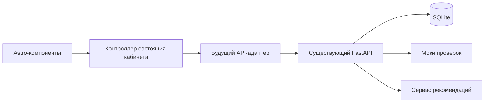
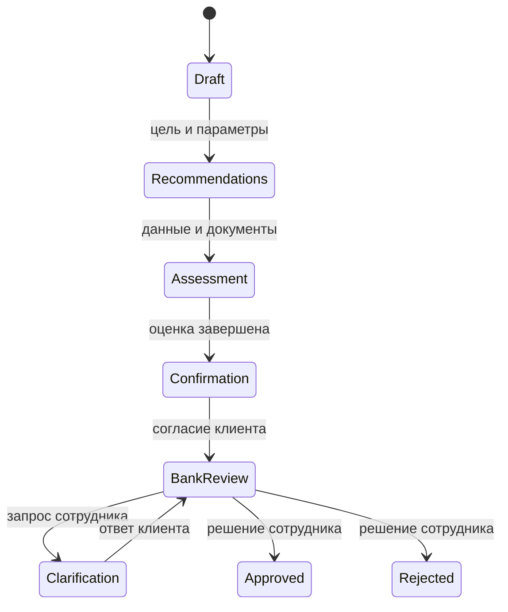

# Следующий этап: интеграция с FastAPI

В этой задаче backend не изменялся. Ниже — проверенные по существующему коду точки интеграции, а не уже работающая связь.

| Этап | Существующая точка | Что добавить во frontend |
| --- | --- | --- |
| Авторизация | Подключённые роутеры FastAPI Users в main.py | Вход, регистрация, восстановление, запрос текущего пользователя; не сохранять пароли |
| Подбор продукта | POST `/credit/recommendations` | Передать goal, requestedAmount, requestedMonths; сохранить токен и выбранный offer id в памяти |
| Документы | POST `/credit/documents` | Загрузка, просмотр распознанных полей, проверка доступа |
| Оценка | POST `/credit/assessments` | Полный AssessmentInput: токен, оффер, компания, ИНН, revenue, expenses, debt, age, документы, уточнения |
| Согласие и отправка | POST `/credit/confirm` | Отправить assessment_token, неизменные оценённые данные и новое явное consent |
| История | GET `/credit/applications` и `/{application_id}` | Заменить синтетические строки серверным источником |
| Уточнения | POST `/credit/applications/{application_id}/clarification` | Экран запроса уточнений и повторная отправка |
| Сотрудник | GET `/bank/me`, `/bank/applications`, POST `/bank/applications/{application_id}/actions` | Отдельный кабинет по серверной роли, действия с контролем версии заявки |

Текущая четырёхшаговая форма работает как локальная симуляция для показа дизайна. Нельзя отправлять её как готовый AssessmentInput: отсутствуют серверный подбор, серверный идентификатор оффера и подписанные токены. Расчёт в UI не заменяет серверную проверку.

При интеграции предпочтителен один origin через reverse proxy: Astro-статика отдельно, API-маршруты проксируются в FastAPI. Cookie, CSRF/CORS, обработка 401/409/422, истечение токенов и разграничение ролей должны следовать серверному контракту. Не помещать секреты и ключи провайдеров в PUBLIC-переменные или клиентский JS.

## Заметки по заданию хакатона

В переданном PDF указаны Docker, воспроизводимые версии, синтетические данные, сквозной процесс клиента и сотрудника, архитектура/API/модель состояний, независимость проверяемой версии от платных ресурсов и открытые веса при использовании LLM. Эти пункты требуют отдельной проверки всего продукта. UI-демо само по себе не завершает сквозной банковский процесс.

Существующий README описывает зависимость рекомендаций от CometAPI и SMTP для восстановления. Перед сдачей необходимо обеспечить автономный бесплатный путь и внутрипро­дуктовый сценарий; проверить выбранную модель и возможность локального запуска. В этой задаче платные сервисы не вызывались.

Состояния для будущей связки (сверить с backend перед реализацией):

Материалы третьих сторон и их права перечислены в THIRD_PARTY_NOTICES. Для распространения за пределами учебного демо проверьте право использования брендовых шрифтов и графики.
